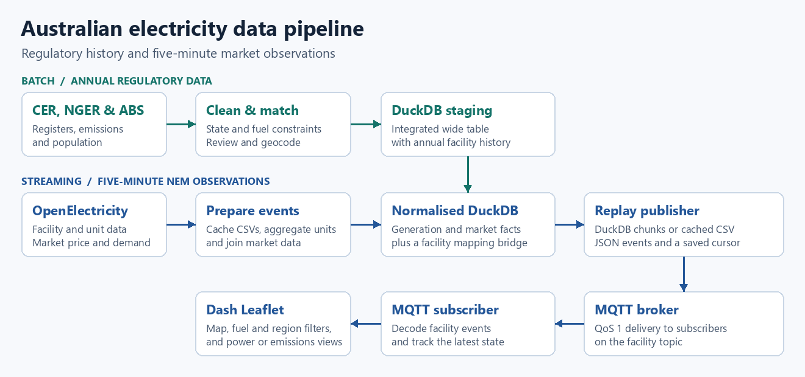
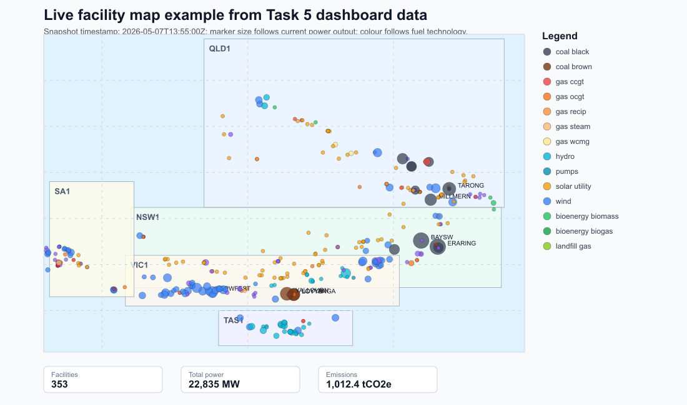

# Australian Electricity Data Pipeline

A two-stage data engineering project for Australian electricity generation and emissions. The batch notebook reconciles a decade of regulatory data and builds a DuckDB staging table. The streaming notebook combines that history with five-minute National Electricity Market (NEM) observations and replays them over MQTT to a dashboard. The work demonstrates controls relevant to AML and risk analytics, including conservative entity matching, review queues, key checks, and stateful event monitoring.

## Highlights

- Resolve facility identities across source systems using exact and fuzzy matching, eligibility rules, and reviewed overrides. Keep unmatched records and export diagnostics for review.
- Separate facility generation from region-level market data in DuckDB. Validate the expected keys and check for orphaned references.
- Replay cached events in timestamp order with an MQTT publish cursor. A Dash Leaflet subscriber shows the latest observation per facility.

## Architecture



The [batch schema diagram](batch_pipeline/schema_design.png) distinguishes the proposed logical model from the implemented `integrated_energy_wide` table. The second notebook uses that table as staging and adds seven normalised tables.

## Pipeline

| Stage | What it does | Tools |
| --- | --- | --- |
| Batch acquisition | Download ten NGER electricity-sector releases, CER renewable project registers, and ABS population data. Supplement missing population values from quarterly ABS estimates. | requests, pandas, openpyxl |
| Batch integration | Harmonise schemas, match eligible CER and NGER facilities within state and compatible fuel categories, and join ABS data by state and year. | pandas, RapidFuzz |
| Batch enrichment and load | Add facility coordinates with an optional postcode fallback, preview them on a map, and load the integrated wide table. | Nominatim-compatible geocoder, Folium, DuckDB |
| NEM acquisition and cleaning | Cache a week of five-minute unit metrics, aggregate them to facility and timestamp, and join price and demand by region and timestamp. | OpenElectricity SDK, pandas |
| DuckDB integration | Build dimensions, annual and five-minute facts, and an OpenElectricity-to-batch facility bridge using fuel compatibility, name similarity, location where available, and reviewed overrides. | DuckDB, pandas |
| MQTT replay and monitoring | Publish ordered JSON with QoS 1, resume from a saved timestamp/facility cursor, and update a live map from the latest facility observations. The replay reads DuckDB chunks with a CSV fallback. | Paho MQTT, Mosquitto, Dash Leaflet |

## Results and validation

These figures describe the saved project runs. The CER registers are updated over time, and geocoding and bridge coverage can vary with the available coordinates.

| Check | Observed result |
| --- | --- |
| NGER ingestion | 5,942 raw rows and 4,880 cleaned rows across 2014–15 to 2023–24 |
| Batch entity matching | 7 of 156 eligible CER facilities matched (4.49%). Six used reviewed overrides. The eligible review queue contained 149 facilities. |
| ABS population and geocoding | 80 state-year rows with no missing estimated resident population after supplementation. The saved geocoding run returned coordinates for 129 of 157 stations (82.2%), including approximate fallback locations. |
| Batch DuckDB | 5,029 rows in the saved wide-table run. Table presence, required fields, and non-empty load passed. |
| NEM acquisition | 2,132,012 raw facility time-series rows and 24,192 raw market rows in the notebook's validation output |
| NEM consolidation | 710,406 observations across 353 active facilities, 2,016 five-minute timestamps, and five NEM regions. Zero duplicate timestamp/facility keys and zero missing power, emissions, price, or demand in the checked fields. |
| Normalised DuckDB | 710,406 generation rows and 10,080 region-time market rows. Checked primary keys were unique and all tested foreign-key relationships had zero orphans. |
| Facility bridge | 307 of 431 OpenElectricity facility records linked in the saved notebook run (71.2%). |
| MQTT integration | The saved five-message test recorded five decoded messages and five DuckDB upsert attempts. |

The portfolio copy was rebuilt from cached source CSVs and reproduced the 710,406 generation rows and 307 bridge links. A local Mosquitto test delivered five replayed events to the subscriber, and the Dash page responded to a test request.



The map is a snapshot of the dashboard inputs at 2026-05-07 13:55 UTC. In the live dashboard, marker size switches between power and emissions and the subscriber state refreshes every two seconds.

## Project contributions

Completed as a team project for COMP5339 at the University of Sydney in Semester 1, 2026. The team covered data acquisition and caching, cleaning and entity resolution, database integration, and MQTT replay and dashboard validation.

## Repository layout

| Path | Contents |
| --- | --- |
| [`batch_pipeline/`](batch_pipeline/energy_batch_pipeline.ipynb) | Batch notebook and schema diagram |
| [`streaming_pipeline/`](streaming_pipeline/nem_mqtt_replay_dashboard.ipynb) | NEM streaming notebook, architecture diagram, and dashboard snapshot |
| [`data/README.md`](data/README.md) | Official data sources and generated output locations |

## Reproduce

Use Python 3.11 or 3.12. Activate a virtual environment, then run these commands from the repository root.

```bash
python -m pip install -r requirements.txt
jupyter lab
```

1. Open the [batch notebook](batch_pipeline/energy_batch_pipeline.ipynb) and run Tasks 1–4. It downloads inputs and generates the staging database at `data/batch/Task4_output/energy_task4.duckdb`. Set the optional geocoding endpoint before running Task 3 if you want coordinates.
2. Open the [streaming notebook](streaming_pipeline/nem_mqtt_replay_dashboard.ipynb). Set `OPENELECTRICITY_API_KEY` and enable `RUN_SMOKE_TEST` for a small API check. Then disable the smoke test, enable `RUN_FULL_RETRIEVAL`, and run the configuration and retrieval cells to cache the week of 1–7 May 2026. Turn full retrieval off after the cache is ready.
3. Enable `RUN_TASK2_PROCESSING` and `RUN_TASK2_VALIDATION` to generate and check the cleaned CSVs. Enable `RUN_TASK4` and run section 14 to copy the batch database and build the seven normalised tables in `data/streaming/Task4_output/energy_task4.duckdb`.
4. Start a local MQTT broker such as Mosquitto. In one kernel, enable `RUN_TASK5_SUBSCRIBER` and `RUN_TASK5_DASHBOARD` in the streaming notebook and open the local dashboard on port 8050. In a second kernel, load the notebook definitions with build and runtime switches off, then enable `RUN_TASK6_DEMO` to replay two chunks of 300 observations. Use a fresh or reset cursor to replay from the beginning.

See the [data guide](data/README.md) for official sources, input windows, and generated files.

| Environment variable | Purpose |
| --- | --- |
| `OPENELECTRICITY_API_KEY` | Required for API retrieval. Use the process environment or a local repository-root `.env`. |
| `NOMINATIM_SEARCH_URL` | Optional search endpoint on your own or authorised Nominatim-compatible service. Set in the process environment. The batch notebook leaves coordinates null when unset. |
| `MQTT_HOST`, `MQTT_PORT`, `MQTT_TOPIC` | Broker settings. Defaults are `localhost`, `1883`, and `comp5339/assignment2/nem/facility`. |
| `TASK6_CHUNK_SIZE` | Records per continuous replay round. Defaults to `3000`. |
| `DASHBOARD_PORT` | Local Dash port. Defaults to `8050`. |
| `ENABLE_DB_UPSERT`, `TASK4_DB` | Optional subscriber writes, disabled by default, and an override for the target DuckDB path. |

## 中文简介

这是一个澳大利亚电力数据工程团队项目。批处理整合发电、排放和人口数据，通过约束匹配和人工复核处理跨来源的电站标识。流处理将五分钟发电与市场数据写入 DuckDB，通过 MQTT 回放并在仪表板上展示。项目重点是匹配质量、数据完整性验证和事件监控。
